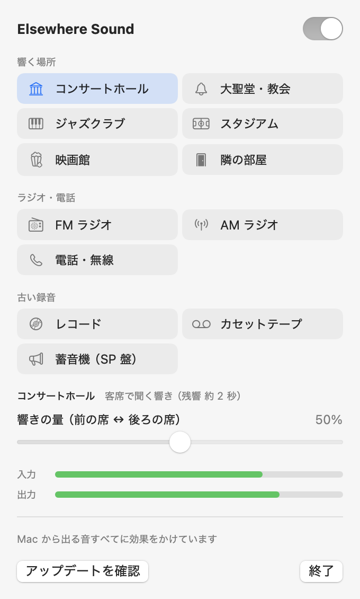
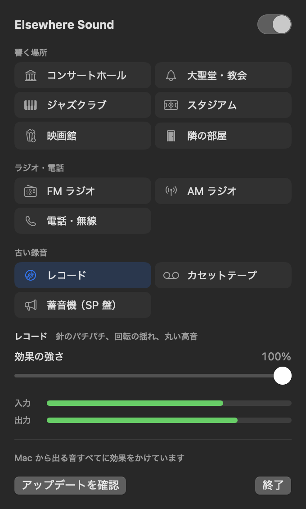

# Elsewhere Sound

Mac から出る音を、コンサートホールや映画館の客席、ラジオ、レコードで聞いているような音に変えるメニューバーアプリです。

<p align="center">
  
  
</p>

## インストール

macOS 15 以降（Apple シリコン・Intel のどちらでも）で使えます。

1. [Releases](https://github.com/Tomopu/elsewhere-sound/releases/latest) から `ElsewhereSound-<バージョン>.dmg` をダウンロードして開き、「Elsewhere Sound」を「Applications」へドラッグします。
2. アプリランチャーや Finder から開きます。Apple の公証を受けていないので、初回は「開けません」と止められます。
   システム設定 →「プライバシーとセキュリティ」の下の方にある「このまま開く」を押すと、次から普通に開けます。
   ターミナルなら、次の 1 行でも同じになります。

   ```bash
   xattr -dr com.apple.quarantine "/Applications/Elsewhere Sound.app"
   ```

3. メニューバーのパネルでオンにして、「システムオーディオ録音」の許可を求められたら許可します。

新しい版は、パネルの「アップデートを確認」で調べられます（押したときだけ GitHub に問い合わせます）。見つかったら、上の 1・2 と同じ手順で入れ替えてください。

---

ビルド方法や仕組み、プリセットの中身は [開発者向けの資料](docs/development.md) にあります。
